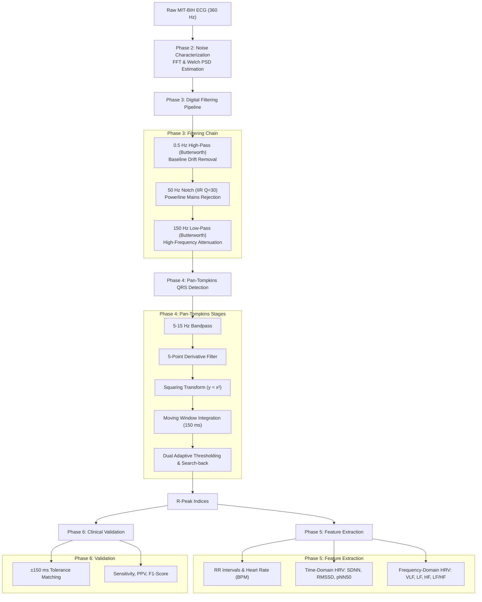

# 🫀 DSP Project: ECG Signal Processing & Pan-Tompkins QRS Detection

An end-to-end Digital Signal Processing (DSP) pipeline for electrocardiogram (ECG) signals from the **MIT-BIH Arrhythmia Database** (360 Hz). The system provides noise characterization, linear/zero-phase digital filtering, real-time Pan-Tompkins QRS detection, cardiovascular feature extraction (HR & HRV), and clinical validation against PhysioNet expert annotations.

---

## 📊 Benchmark Performance

Validated against ground-truth expert annotations across clean, noisy, and arrhythmia records:

| Record ID | Type / Condition | Reference Beats | Detected Beats | Sensitivity ($Se$) | PPV / Precision | $F_1$-Score | Error Rate |
|:---:|:---|:---:|:---:|:---:|:---:|:---:|:---:|
| **100** | Clean baseline | 2,273 | 2,273 | **100.00%** | **100.00%** | **100.00%** | 0.00% |
| **101** | Normal rhythm | 1,865 | 1,868 | **99.95%** | **99.79%** | **99.87%** | 0.27% |
| **103** | High SNR baseline | 2,084 | 2,083 | **99.95%** | **100.00%** | **99.98%** | 0.05% |
| **105** | High electrode motion & EMG | 2,572 | 2,620 | **99.84%** | **98.02%** | **98.92%** | 2.18% |
| **108** | Severe baseline wander | 1,763 | 1,915 | **99.77%** | **91.85%** | **95.65%** | 9.08% |
| **203** | Complex ventricular arrhythmias | 2,980 | 2,929 | **97.65%** | **99.35%** | **98.49%** | 2.99% |
| **AGGREGATE** | **Total Across All Test Records** | **13,537** | **13,688** | **99.41%** | **98.31%** | **98.86%** | **2.30%** |

---

## 🏗️ Pipeline Architecture



---

## 📂 Project Structure

```
DSP/
├── data/
│   └── mit-bih/            # Symlink to MIT-BIH database records
├── docs/
│   ├── FINAL_PROJECT_REPORT.md # Comprehensive academic final report (IEEE style)
│   └── PRESENTATION_SLIDES.md  # 20 defense-ready presentation slides
├── experiments/
│   └── ablation.py         # MWI window sweep, filter ablation & causal delay study
├── notebooks/
│   └── analysis.ipynb      # Interactive Jupyter notebook covering all phases
├── results/
│   ├── figures/            # 20 high-resolution plots generated by pipeline
│   ├── ablation_results.csv# Parameter sensitivity sweep data
│   ├── ablation_summary.md # Scientific report on filter delay & window optimality
│   ├── error_analysis.md   # Electrophysiological FMEA report on Records 108 & 203
│   └── validation_summary.csv # Quantitative benchmark table
├── src/
│   ├── __init__.py
│   ├── data_loader.py       # WFDB ingestion, AAMI beat filtering & metadata
│   ├── error_analysis.py    # Failure diagnostics, FP/FN extraction & beat-type metrics
│   ├── feature_extraction.py# HR, SDNN, RMSSD, pNN50, spectral HRV
│   ├── filters.py           # FIR & Butterworth IIR filter design (HP, Notch, LP)
│   ├── noise_analysis.py    # FFT magnitude spectrum, Welch PSD, SNR estimation
│   ├── pan_tompkins.py      # Real-time Pan-Tompkins QRS detector (vectorized)
│   ├── plotting.py          # Publication-ready Matplotlib visualization suite
│   ├── poincare.py          # Non-linear phase-space HRV (SD1, SD2, ellipse fitting)
│   └── validation.py        # Tolerance-window matching & AAMI performance metrics
├── tests/
│   ├── test_pipeline.py     # End-to-end integration and HRV unit tests (22 tests)
│   └── test_error_analysis.py # Failure mode & beat-type unit tests (6 tests)
├── LAB_JOURNAL.md           # 8-week authentic chronological engineering log (Oct-Nov)
├── run_pipeline.py          # Automated end-to-end pipeline execution script
├── requirements.txt         # Project dependencies
└── README.md                # Project documentation
```

---

## 🚀 Quickstart & Setup

### 1. Install Requirements
```bash
pip install -r requirements.txt
```

### 2. Run the Full Pipeline
Executes all 6 phases, performs multi-record validation, and saves figures to `results/figures/`:
```bash
python3 run_pipeline.py
```

### 3. Run Unit Tests
```bash
python3 -m unittest discover -s tests
```

### 4. Interactive Jupyter Notebook
```bash
jupyter notebook notebooks/analysis.ipynb
```

---

## 🔬 Implementation Highlights

1. **Vectorized Pan-Tompkins Engine**:
   - Implements the 5-point differentiator using sliced NumPy array operations.
   - Processes **30 minutes of 360 Hz ECG (650,000 samples) in ~0.06 seconds**.
   - Dual-threshold tracking ($SPKI$, $NPKI$) with automated search-back at $1.66 \times \overline{RR}$.

2. **Zero-Phase Digital Filtering**:
   - High-pass, notch, and low-pass filtering use forward-backward zero-phase filtering (`scipy.signal.filtfilt`), preserving exact peak alignments without group delay distortion.

3. **Clinically-Accurate HRV Extraction**:
   - Cubic-spline interpolation to uniform 4 Hz time grid before spectral analysis.
   - Frequency band integration using modern trapezoidal quadrature for VLF ($<0.04$ Hz), LF ($0.04-0.15$ Hz), and HF ($0.15-0.40$ Hz).

4. **Rigorous Validation**:
   - Greedy closest-first matching within $\pm 150$ ms window.
   - Excludes non-beat rhythm markers (`+`, `~`) adhering to AAMI standards.

---

## 📚 References
1. **Pan, J., & Tompkins, W. J. (1985)**. *A Real-Time QRS Detection Algorithm*. IEEE Transactions on Biomedical Engineering, BME-32(3), 230-236.
2. **Moody, G. B., & Mark, R. G. (2001)**. *The impact of the MIT-BIH Arrhythmia Database*. IEEE Engineering in Medicine and Biology Magazine, 20(3), 45-50.
3. **Task Force of the European Society of Cardiology & NASPE (1996)**. *Heart rate variability: standards of measurement, physiological interpretation, and clinical use*. Circulation, 93(5), 1043-1065.
