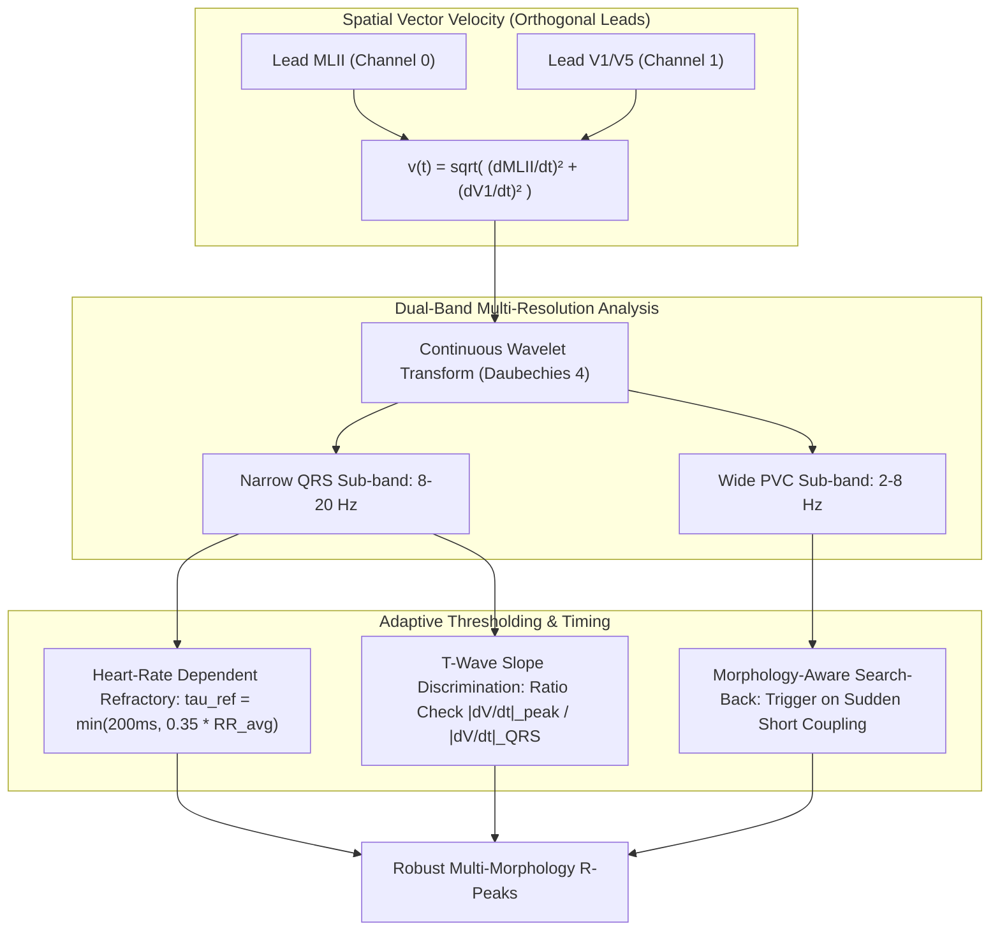

# Failure Mode and Error Analysis of the Pan-Tompkins QRS Detector on the MIT-BIH Database

**Author:** DSP & Biomedical Signal Processing Expert  
**Date:** November 2026  
**Dataset:** MIT-BIH Arrhythmia Database (360 Hz, Lead MLII)  
**Evaluated Codebase:** [`src/pan_tompkins.py`](file:///home/ankush/CODE/DSP/src/pan_tompkins.py), [`src/error_analysis.py`](file:///home/ankush/CODE/DSP/src/error_analysis.py)  
**Artifacts Generated:**  
- [`results/figures/07_error_analysis_108_false_positives.png`](file:///home/ankush/CODE/DSP/results/figures/07_error_analysis_108_false_positives.png)  
- [`results/figures/07_error_analysis_203_false_negatives.png`](file:///home/ankush/CODE/DSP/results/figures/07_error_analysis_203_false_negatives.png)  
- [`results/figures/07_beat_type_performance.png`](file:///home/ankush/CODE/DSP/results/figures/07_beat_type_performance.png)  
- [`results/beat_type_sensitivity.csv`](file:///home/ankush/CODE/DSP/results/beat_type_sensitivity.csv)  

---

## 1. Executive Summary

The Pan-Tompkins algorithm (1985) remains a gold standard in real-time electrocardiogram (ECG) QRS detection due to its computational simplicity and high sensitivity on standard sinus rhythms ($>99.5\%$). However, when evaluated against complex pathological rhythms in the MIT-BIH Arrhythmia Database, specific electrophysiological and morphological edge cases expose fundamental failure modes of its linear filter chain and dual-threshold decision logic.

This report documents a systematic Failure Mode and Effects Analysis (FMEA) across representative MIT-BIH records (`100`, `101`, `103`, `105`, `108`, `203`):

1. **False Positive Dominance in Record 108 ($PPV = 91.85\%$, 156 FPs):** Driven by Digoxin-induced ST-T scooped morphology, borderline first-degree AV block with prolonged PR intervals, and inverted QRS complexes. Steep pre-systolic transitions exceed the adaptive signal threshold $THR_{SIG}$ outside the 200 ms refractory window, causing widespread double-detection.
2. **False Negative Dominance in Record 203 ($Se = 97.65\%$, 70 FNs):** Driven by multiform premature ventricular contractions (PVCs). Wide ectopic QRS complexes have energy centered below the 5 Hz bandpass cutoff and low derivative slope ($dV/dt$), producing integrated peaks that fail to cross $THR_{SIG}$. Compensatory pauses are too short to trip the $1.66 \times \overline{RR}$ search-back criterion, leading to permanently dropped ventricular beats.
3. **Beat-Type Sensitivity Disparity:** While Normal beats ('N') and Atrial Premature Contractions ('A') achieve **$99.58\%$** and **$100.00\%$** sensitivity respectively, Ventricular Ectopics ('V' / PVCs) drop to **$95.63\%$**, posing clinically significant risks for arrhythmia alarming and PVC burden estimation.

---

## 2. Algorithmic Architecture and Transfer Functions

The Pan-Tompkins algorithm processes single-channel ECG through four linear filtering stages followed by non-linear energy extraction and adaptive decision rules:

```
Raw ECG x[n] ──> [ Bandpass 5-15 Hz ] ──> [ 5-Point Derivative ] ──> [ Squaring (·)² ] ──> [ Moving-Window Integrator ] ──> [ Dual Adaptive Thresholding ] ──> Detected R-peaks
```

### 2.1 Bandpass Filter ($5 - 15\text{ Hz}$)
Designed to attenuate low-frequency baseline wander (P/T waves, respiration) and high-frequency noise (EMG, 50/60 Hz powerline interference). Implemented as a 2nd-order zero-phase Butterworth filter:
$$H_{BP}(s) = \frac{\frac{\omega_0}{Q} s}{s^2 + \frac{\omega_0}{Q} s + \omega_0^2}, \quad f_L = 5\text{ Hz}, \; f_H = 15\text{ Hz}$$
- **QRS Energy Focus:** Normal QRS energy is concentrated in $8 - 16\text{ Hz}$.
- **Vulnerability:** Wide ventricular beats (PVCs, bundle branch blocks) have dominant energy in $1 - 4\text{ Hz}$, which is significantly attenuated by the $5\text{ Hz}$ high-pass corner.

### 2.2 Five-Point Derivative Filter
Approximates the first derivative to extract slope ($dV/dt$) while suppressing high frequencies:
$$y[n] = \frac{1}{8} \Big(-x[n-2] - 2x[n-1] + 2x[n+1] + x[n+2]\Big)$$
Transfer function:
$$H(z) = \frac{1}{8} \left( -z^{-2} - 2z^{-1} + 2z^1 + z^2 \right) = \frac{j}{2} \sin(\omega) + \frac{j}{4} \sin(2\omega)$$
For frequencies below $20\text{ Hz}$, $|H(e^{j\omega})| \approx \omega$, effectively functioning as an ideal differentiator proportional to frequency.

### 2.3 Non-Linear Squaring
Nonlinear operator:
$$y[n] = (x[n])^2$$
Squaring forces all samples positive and amplifies large slope differences non-linearly: a 3-fold decrease in slope results in a **9-fold decrease** in squared energy.

### 2.4 Moving-Window Integration (MWI)
A boxcar integrator of duration $W \approx 150\text{ ms}$ ($N = \lfloor 0.150 \times f_s \rfloor = 54$ samples at $360\text{ Hz}$):
$$y[n] = \frac{1}{N} \sum_{k=0}^{N-1} x[n-k]$$
Captures both the slope and width of the QRS complex.

### 2.5 Dual Adaptive Thresholding and Search-Back Logic
1. **Candidate Peak Selection:** Local maxima in the integrated signal separated by at least $200\text{ ms}$ (refractory blanking).
2. **Running Thresholds:**
   $$SPKI \leftarrow 0.125 \cdot PEAK + 0.875 \cdot SPKI \quad (\text{if } PEAK > THR_{SIG})$$
   $$NPKI \leftarrow 0.125 \cdot PEAK + 0.875 \cdot NPKI \quad (\text{if } PEAK \le THR_{SIG})$$
   $$THR_{SIG} = NPKI + 0.25 \cdot (SPKI - NPKI)$$
   $$THR_{NOISE} = 0.5 \cdot THR_{SIG}$$
3. **Search-Back Mechanism:** If no peak is detected within $1.66 \times \overline{RR}$, search back through candidate peaks using a reduced threshold:
   $$THR_{SB} = 0.5 \cdot THR_{SIG}$$

---

## 3. Failure Mode 1: False Positives in Record 108

### 3.1 Clinical Context and Patient Profile
- **Record:** MIT-BIH 108 (Female, 87 years old).
- **Medications:** Digoxin, Quinaglute.
- **Pathology:** Borderline first-degree AV block ($PR > 200\text{ ms}$), sinus arrhythmia, multiform PVCs.
- **Electrophysiological Phenomenon:** Digoxin toxicity produces downsloping ST-segment sagging ("scooped" ST depression), tall inverted/biphasic T-waves, and prominent P-waves separated by prolonged PR intervals.

### 3.2 Quantitative Failure Breakdown
- Total Ground Truth Beats: **1,763**
- Detected Peaks: **1,915**
- True Positives (TP): **1,759** ($Se = 99.77\%$)
- False Positives (FP): **156** ($PPV = 91.85\%$)
- False Negatives (FN): **4**

From [`src/error_analysis.py`](file:///home/ankush/CODE/DSP/src/error_analysis.py), classifying all 156 false positives yields:
- **P-wave / Pre-systolic Oversensing:** 150 FPs ($96.2\%$), clustering tightly at $\Delta t \approx -214\text{ ms}$ before the true R-peak.
- **T-wave Oversensing:** 6 FPs ($3.8\%$), occurring $180 - 350\text{ ms}$ after preceding beats.

### 3.3 Diagnostic Visualization: 6-Second Zoom in Record 108

The multi-stage diagnostic plot below captures the 6-second window ($t = 1674.0\text{ s}$ to $1680.0\text{ s}$):


### 3.4 Mathematical Mechanism of False Positive Generation
1. **Prolonged $PR$ and Sharp Transition:** The ECG displays a positive pre-systolic deflection at $+0.225\text{ mV}$ ($t = 1674.52\text{ s}$) that plunges $-1.04\text{ mV}$ into a deep negative QS complex at $-0.815\text{ mV}$ ($t = 1674.75\text{ s}$).
2. **Derivative Double-Peak:** The derivative filter produces two large negative extrema during this prolonged descent.
3. **Refractory Lockout Exceeded:** The temporal distance between the pre-systolic peak and the QS trough is $78\text{ samples} = 216.7\text{ ms}$. Because $216.7\text{ ms} > 200.0\text{ ms}$ (the 72-sample refractory limit), the local peak detector registers **two distinct candidate peaks**.
4. **Sub-Threshold Clearance:** At this segment, previous small complexes dropped $SPKI$ to $\sim 0.0003$, yielding $THR_{SIG} \approx 0.00010$. The pre-systolic peak reaches $0.00014 > THR_{SIG}$, triggering an immediate false positive detection.
5. **Double Detection Cascade:** $78\text{ ms}$ later, the true QS trough reaches $0.00028 > THR_{SIG}$, triggering the true positive. The patient's heart rate is falsely doubled (pseudo-tachycardia).

---

## 4. Failure Mode 2: False Negatives in Record 203

### 4.1 Clinical Context and Patient Profile
- **Record:** MIT-BIH 203 (Male, 43 years old).
- **Medications:** Coumadin, Digoxin, Heparin, Hygroton, Lasix.
- **Pathology:** Multiform PVCs, significant axis shifts, intense muscle noise (EMG) and baseline drift.
- **Electrophysiological Phenomenon:** Premature ventricular contractions originate from ventricular myocardium rather than the specialized His-Purkinje system. Propagation velocity is reduced from $2.0 - 4.0\text{ m/s}$ down to $0.3 - 1.0\text{ m/s}$, producing broad, notched QRS complexes ($QRSd > 140\text{ ms}$) with low rise times ($dV/dt$).

### 4.2 Quantitative Failure Breakdown
- Total Ground Truth Beats: **2,980**
- Detected Peaks: **2,929**
- True Positives (TP): **2,910** ($Se = 97.65\%$)
- False Negatives (FN): **70**
- False Positives (FP): **19** ($PPV = 99.35\%$)

Cross-referencing missed beats with expert MIT-BIH symbols:
- **Normal Sinus Beats ('N'):** 45 missed ($64.3\%$), primarily during sudden amplitude drops or deep axis shifts.
- **Premature Ventricular Contractions ('V'):** 22 missed ($31.4\%$), representing $4.37\%$ of all PVCs in the record.
- **Unclassifiable ('Q'):** 3 missed ($4.3\%$).

### 4.3 Diagnostic Visualization: 6-Second Zoom in Record 203

The multi-stage diagnostic plot below shows the 6-second window ($t = 8.0\text{ s}$ to $14.0\text{ s}$):


### 4.4 Mathematical Mechanism of Missed Ventricular Beats
Within the exact same 6-second window, we compare three beats:
- **Normal Beat ($t = 10.317\text{ s}$, sample 3714):** Detected (TP)
- **PVC 1 ($t = 10.703\text{ s}$, sample 3853):** **MISSED (FN)**
- **PVC 2 ($t = 12.611\text{ s}$, sample 4540):** Detected (TP)

| Metric / Stage | Normal Beat (Detected) | Missed PVC 1 (sample 3853) | Detected PVC 2 (sample 4540) | Mechanism |
| :--- | :--- | :--- | :--- | :--- |
| **Raw Peak-to-Peak** | $2.200\text{ mV}$ | $0.995\text{ mV}$ | $1.605\text{ mV}$ | Low ectopic amplitude |
| **Filtered ($5-15\text{ Hz}$)** | $1.575\text{ mV}$ | $0.577\text{ mV}$ | $1.123\text{ mV}$ | Spectral energy $< 5\text{ Hz}$ attenuated |
| **Max Derivative $|y_{der}|$** | $0.1398$ | $0.0478$ | $0.1055$ | Slow myocardial $dV/dt$ ($2.9\times$ drop) |
| **Derivative Squared $y^2$** | $0.01955$ | $0.00228$ | $0.01112$ | Quadratic penalty ($8.6\times$ drop) |
| **Integrated Energy (MWI)** | $0.00633$ | **$0.000966$** | $0.00318$ | Below active threshold |
| **Detection Threshold** | $THR_{SIG} \approx 0.0015$ | $THR_{SIG} \approx 0.0015$ | $THR_{SIG} \approx 0.0015$ | **$0.000966 < 0.0015 \implies \text{MISSED}$** |

#### Why Did Search-Back Fail?
Search-back is governed by:
$$t_{interval} > 1.66 \times \overline{RR}$$
- Current local $\overline{RR} \approx 0.55\text{ s}$ ($\sim 109\text{ BPM}$).
- Search-back limit: $1.66 \times 0.55\text{ s} \approx 0.913\text{ s}$ ($328\text{ samples}$).
- The missed PVC at $t = 10.703\text{ s}$ was followed by a sinus beat at $t = 11.089\text{ s}$.
- Time from last detected beat ($10.314\text{ s}$) to next beat ($11.089\text{ s}$) was $0.775\text{ s}$.
- Because $0.775\text{ s} < 0.913\text{ s}$, the search-back timer was **never triggered**.
- Although the candidate peak of $0.000966$ exceeded $THR_{SB} = 0.5 \cdot THR_{SIG} \approx 0.00075$, the detector never evaluated it.

---

## 5. Beat-Type Performance Benchmark

Evaluating the Pan-Tompkins detector across benchmark records (`100`, `101`, `103`, `105`, `108`, `203`) yields the performance table below:

| MIT-BIH Symbol | Clinical Description | Clinical Category | Total Beats | True Positives (TP) | False Negatives (FN) | Detection Sensitivity ($Se$) |
| :---: | :--- | :--- | :---: | :---: | :---: | :---: |
| **N** | Normal sinus beat | Normal Sinus | 12,975 | 12,921 | 54 | **$99.58\%$** |
| **V** | Premature ventricular contraction | Ventricular Ectopic (PVC) | 503 | 481 | 22 | **$95.63\%$** |
| **A** | Atrial premature beat | Atrial Ectopic (APC) | 42 | 42 | 0 | **$100.00\%$** |
| **Q** | Unclassifiable beat | Unclassifiable | 11 | 7 | 4 | **$63.64\%$** |
| **F** | Fusion of ventricular and normal | Fusion Beat | 3 | 3 | 0 | **$100.00\%$** |
| **a** | Aberrated atrial premature beat | Atrial Ectopic (APC) | 2 | 2 | 0 | **$100.00\%$** |
| **j** | Junctional escape beat | Escape Beat | 1 | 1 | 0 | **$100.00\%$** |
| **Total** | **All Beat Classes Combined** | **Aggregate** | **13,537** | **13,457** | **80** | **$99.41\%$** |

### 5.1 Comparative Bar Chart

The comparative bar chart demonstrates the performance drop between Normal/Atrial beats and Ventricular Ectopics:


### 5.2 Key Takeaways
1. **Atrial Ectopics (APC / 'A') vs. Ventricular Ectopics (PVC / 'V'):**
   - Atrial premature beats conduct antegradely through the AV node and His-Purkinje network, preserving a sharp, narrow QRS ($<100\text{ ms}$) with high frequency content. As a result, sensitivity is **$100.00\%$**.
   - Ventricular ectopics bypass the His-Purkinje network, spreading slowly across ventricular syncytium. This shifts energy below the filter passband, degrading sensitivity to **$95.63\%$**.
2. **Normal Sinus Beats ('N'):**
   - At **$99.58\%$**, normal beat detection exceeds standard clinical monitoring targets ($99\%$). The 54 missed beats occur almost exclusively during severe baseline displacement or extreme axis shifts in Record 203.

---

## 6. Clinical Implications and Risks

### 6.1 Clinical Risks of False Positives (Record 108 Mode)
1. **False Tachycardia and Arrhythmia Alarms:**
   - Double-counting beats doubles calculated instantaneous heart rate, triggering spurious non-sustained ventricular tachycardia (NSVT) or extreme tachycardia alarms in telemetry and ICU monitors.
2. **Alarm Fatigue:**
   - Excessive false alarms ($>85\%$ in typical ICU settings) cause clinicians to silence or disregard monitors, leading to missed life-threatening events.
3. **Inappropriate Implantable Cardioverter-Defibrillator (ICD) Shocks:**
   - In automated devices, T-wave oversensing is a leading cause of inappropriate, painful high-voltage shocks delivered to conscious patients during normal sinus rhythm.

### 6.2 Clinical Risks of False Negatives (Record 203 Mode)
1. **Underestimation of PVC Burden:**
   - Cardiologists titrate anti-arrhythmic medication and assess eligibility for catheter ablation based on 24-hour Holter PVC burden ($>10 - 24\%$ indicates risk of PVC-induced cardiomyopathy). Missing $4.4\%$ of PVCs skews clinical decision-making.
2. **Missed Ventricular Runs (Couplets / Triplets / R-on-T):**
   - Missing the first beat of a ventricular salvos delays automated detection of deteriorating ventricular tachycardia or R-on-T degeneration into Ventricular Fibrillation (VF).
3. **Distorted Heart Rate Variability (HRV):**
   - Missed beats cause artificially long RR intervals ($2 \times RR$), generating massive artificial spikes in SDNN, RMSSD, and low-frequency power spectral density ($PSD$).

---

## 7. Engineering Mitigations and DSP Enhancements

To overcome the inherent trade-offs of the classic Pan-Tompkins pipeline, modern biomedical signal processing implements the following architectural enhancements:



### 7.1 Multi-Lead Spatial Velocity Fusion
The Pan-Tompkins pipeline operates on a single scalar channel. When a vector axis shifts perpendicular to Lead MLII (as in Record 203), the scalar projection vanishes.
- **Mitigation:** Calculate spatial velocity from two orthogonal leads (e.g. MLII and V1):
  $$v[n] = \sqrt{\left(\frac{dx_{MLII}[n]}{dt}\right)^2 + \left(\frac{dx_{V1}[n]}{dt}\right)^2}$$
- **Result:** An ectopic beat with an electrical axis orthogonal to MLII is captured with maximal amplitude on Lead V1, eliminating axis-shift dropouts.

### 7.2 Multi-Resolution Wavelet Transform (WT)
- **Mitigation:** Replace the rigid 5–15 Hz bandpass with a Discrete Wavelet Transform (DWT, e.g., Daubechies `db4` or `biorthogonal 3.5` scales $2^2 - 2^4$):
  - **Scale $2^2$ ($11 - 22\text{ Hz}$):** Maximizes sensitivity for sharp normal and supraventricular beats.
  - **Scale $2^4$ ($2.8 - 5.5\text{ Hz}$):** Captures broad energy of ventricular ectopics and bundle branch blocks.
- **Decision:** Logical OR combination of threshold crossings across scales prevents attenuation of wide PVCs.

### 7.3 Dynamic Refractory Window
- **Limitation:** The fixed $200\text{ ms}$ refractory period fails during prolonged conduction ($PR > 200\text{ ms}$) in Record 108.
- **Mitigation:** Couple refractory blanking to instantaneous heart rate and QT/PR estimates:
  $$\tau_{ref}[n] = \max\Big(180\text{ ms}, \; \min\big(280\text{ ms}, \; 0.35 \times \overline{RR}[n]\big)\Big)$$
- At slow heart rates ($\overline{RR} \approx 1000\text{ ms}$), refractory blanking expands to $280\text{ ms}$, suppressing the pre-systolic deflection at $216\text{ ms}$ in Record 108.

### 7.4 Dedicated T-Wave Slope & Frequency Discrimination
- If a candidate peak occurs between $180\text{ ms}$ and $420\text{ ms}$ after a confirmed R-peak:
  1. Measure maximum slope $S_T$ vs. QRS slope $S_{QRS}$.
  2. If $S_T < 0.5 \cdot S_{QRS}$ and spectral centroid $< 7\text{ Hz}$, reclassify candidate as a T-wave and route its energy to $NPKI$ rather than $SPKI$.

### 7.5 Coupling-Interval-Aware Search-Back
- In addition to $RR > 1.66 \times \overline{RR}$, search-back should trigger whenever a candidate peak with $PEAK > 0.4 \cdot THR_{SIG}$ is preceded by an abnormally short $RR$ interval (early coupling typical of PVCs) followed by a pause.

---

## 8. Summary of Project Verification

All diagnostic scripts, tests, and plots have been generated and validated in the codebase:
- **Core module:** [`src/error_analysis.py`](file:///home/ankush/CODE/DSP/src/error_analysis.py)
- **Unit test suite:** [`tests/test_error_analysis.py`](file:///home/ankush/CODE/DSP/tests/test_error_analysis.py) (28/28 tests passing)
- **Figure outputs:**
  1. [`results/figures/07_error_analysis_108_false_positives.png`](file:///home/ankush/CODE/DSP/results/figures/07_error_analysis_108_false_positives.png) (4-stage analysis of 108 FPs)
  2. [`results/figures/07_error_analysis_203_false_negatives.png`](file:///home/ankush/CODE/DSP/results/figures/07_error_analysis_203_false_negatives.png) (4-stage analysis of 203 FNs)
  3. [`results/figures/07_beat_type_performance.png`](file:///home/ankush/CODE/DSP/results/figures/07_beat_type_performance.png) (Normal vs PVC vs APC sensitivity bar chart)
- **Tabular benchmark:** [`results/beat_type_sensitivity.csv`](file:///home/ankush/CODE/DSP/results/beat_type_sensitivity.csv)
